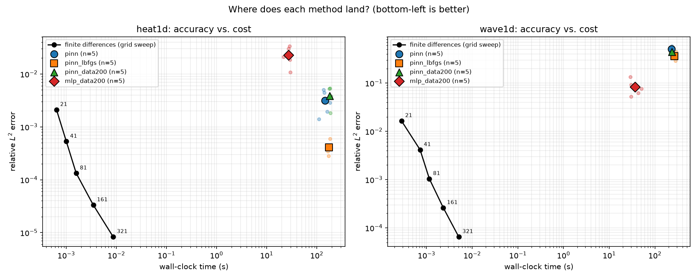
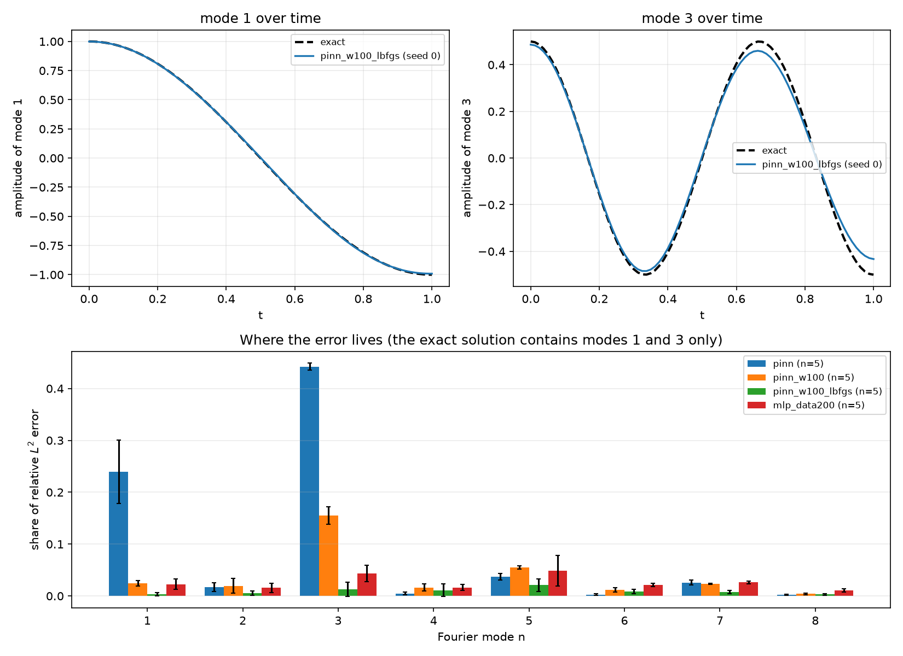
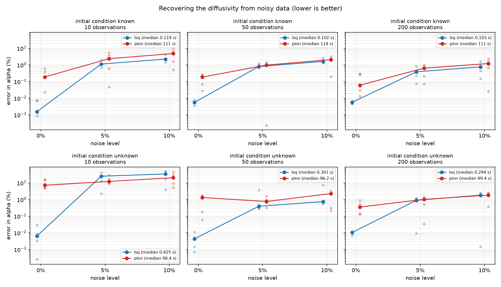

# pinn-audit


**When does a physics-informed neural network beat a classical solver?**
A reproducible audit of accuracy per unit of compute on forward problems, on inverse
problems, and (in progress) as the dimension grows.

**Scope.** Smooth, linear PDEs in one space dimension with exact solutions (heat and
wave), and one inverse parameter (the heat diffusivity). Nothing here yet covers
nonlinear PDEs, shocks, complex geometry or high dimension, and the conclusions below
should not be read beyond that.



## The question

Numerical solvers have handled partial differential equations reliably for about
seventy years. Since 2019, physics-informed neural networks (PINNs) have been pitched
as a rival with three promises: flexibility, tolerance of messy and sparse data, and a
way past the curse of dimensionality. Published evidence is scattered across papers
with different problems, metrics and baselines, so the practical question has no
single answer: when does the network actually win?

This repository tests the promises one at a time against exact solutions, with strong
classical baselines, cost reported next to error, and predictions written down before
the runs and scored afterwards.

## The answer so far

| Promise | Result on smooth linear 1D problems |
|---|---|
| Better forward solver | **No.** The classical solver wins on accuracy per second by roughly 10^3 to 10^6 |
| Better with sparse, noisy data (inverse problems) | **Mostly no.** Classical wins when the model is fully specified. A PINN had the lower median error in one regime only (10 noisy observations, initial condition unknown), where both methods were unreliable |
| Better as dimension grows | **Not yet tested** (next) |

## How the comparison is kept fair

- **Exact answers.** Every problem has a closed-form solution, so error is measured
  against the truth and not against another approximation.
- **Verified baselines.** Each classical scheme reproduces its theoretical convergence
  order before it is used, and is run at five grid sizes so the PINN meets a
  cost-and-accuracy curve and not one point.
- **One scoreboard.** Relative L2 error and wall-clock time, on one CPU thread in
  float64, for every method.
- **Repeats and controls.** Five seeds per setting. A network with no physics term, and
  a PINN given the same observations, show what the physics is worth.
- **Written predictions.** Predictions are recorded before runs and scored afterwards,
  wrong ones included. [`docs/PROTOCOL.md`](docs/PROTOCOL.md) separates what was fixed
  in advance from what was decided after seeing data, and
  `python scripts/check_chronology.py` checks the commit times against the run times.

## Forward problems

Mean over five seeds. Neural solvers are scored on a 41-point grid.

| Method | Heat error | Heat time | Wave error | Wave time |
|---|---|---|---|---|
| Finite differences, 41 points | 5.3e-4 | 1.0 ms | 4.2e-3 | 0.7 ms |
| PINN | 3.1e-3 | 147 s | 5.1e-1 | 230 s |
| PINN + L-BFGS | 4.1e-4 | 175 s | 3.6e-1 | 268 s |
| PINN + 200 observations | 3.8e-3 | 180 s | 4.4e-1 | 234 s |
| PINN + loss weight 100 + L-BFGS | 1.2e-3 | 174 s | 3.3e-2 | 255 s |
| Network with no physics, 200 observations | 2.3e-2 | 27 s | 8.4e-2 | 36 s |

- **The classical solver wins on both problems.** On heat, the best PINN (L-BFGS, 4.1e-4
  in 175 s) is matched by a 41-point grid (5.3e-4 in 1 ms). On the wave equation, the
  best tuned PINN has about twice the error of the coarsest grid I ran (21 points,
  0.28 ms) and takes about a million times longer.
- **Optimiser and loss balance matter a great deal.** On the wave problem,
  rebalancing the loss weights and adding L-BFGS together cut the error 15 times
  (0.51 to 0.033), more than the product of the separate effects (2.9 and 1.4 times).
  That L-BFGS helps PINN training is known (Rathore et al., 2024); whether this
  interaction with the loss weights holds more generally is untested here. A weight
  tuned on the wave problem made the heat PINN worse than L-BFGS alone, and heat was
  not tuned separately.
- **The wave failure is concentrated in one mode.** The plain PINN misses the third
  harmonic (its share of the error is 0.44). With balanced weights and L-BFGS it is
  learned (0.013, better than the no-physics network's 0.043), so the failure was one
  of loss balance for that mode. Higher frequencies were not tested.



## Inverse problem

Recover the heat diffusivity (true value 0.05) from noisy observations at random
points. The classical method is a nonlinear least-squares fit of a numerical solver.
The PINN learns the solution and the diffusivity together. Both start from the same
wrong guess (0.2) and see identical data. Setting A gives both methods the initial
condition; in setting B it is unknown, so the classical fit also estimates six sine-mode
amplitudes and the PINN drops its initial-condition term. Median over five seeds:

| Setting | Observations | Noise | Classical error | PINN error | Classical time | PINN time |
|---|---|---|---|---|---|---|
| Initial condition known | 50 | 0% | 0.0056% | 0.19% | 0.09 s | 120 s |
| Initial condition known | 50 | 5% | 0.81% | 0.99% | 0.11 s | 112 s |
| Initial condition unknown | 50 | 5% | 0.40% | 0.77% | 0.29 s | 95 s |
| Initial condition unknown | 10 | 5% | 25% | 12% | 0.65 s | 99 s |

- **With the model fully specified, the classical fit wins every cell,** and the PINN is
  about a thousand times slower. Once there is noise both are limited by it, and the
  PINN's error is 1.2 to 2.2 times the classical one.
- **With the initial condition unknown, the PINN had the lower median only at 10 noisy
  observations,** where both methods are unreliable (the classical fit reaches 25% to
  35% error), the ranges overlap, and the classical baseline is unregularised. I read
  this as suggestive and not conclusive.



## Limitations

- Scope: two linear problems in 1D and one inverse parameter (see the top of this page).
- Settings were chosen by looking at seeds 0 to 4 and reported on the same seeds. A
  confirmation run on held-out seeds 5 to 9 is planned.
- The PINN received more tuning than the classical solvers, which needed none.
- Timings come from one machine and vary by up to about two-fold between sessions, so
  time ratios are orders of magnitude.
- Five seeds support medians and ranges, not significance claims.

The full list, with how each was or will be handled, is in
[`docs/PROTOCOL.md`](docs/PROTOCOL.md).

## Status

| Step | Status |
|---|---|
| Exact solutions and verified classical baselines | done |
| Forward heat and wave, classical against PINN, five seeds | done |
| What helps the PINN: optimiser, data, loss weights | done |
| Inverse problem, initial condition known and unknown | done |
| Confirmation on held-out seeds, bootstrap statistics, regularised classical baseline | next |
| Dimension study: Poisson in 1 to 5 dimensions | next |
| Written report | planned |
| Burgers' equation (shocks) | optional, future work |

## Reproduce

Python 3.11 or newer.

```bash
git clone https://github.com/ridoy1211/pinn-audit
cd pinn-audit
python -m venv .venv
.venv\Scripts\activate            # macOS / Linux: source .venv/bin/activate
pip install -e ".[dev,nn]"

pytest                            # tests, including convergence-order and autograd checks
pinnaudit sweep --config configs/sweeps/forward_heat.yaml --n-seeds 1
pinnaudit summary --name forward_heat
pinnaudit inverse --config configs/inverse/heat_known_ic.yaml --method lsq
python scripts/plot_pareto.py --name forward_heat forward_wave
```

Classical runs take milliseconds. Each neural run takes minutes on a laptop CPU, so a
full five-seed sweep takes hours. Sweeps are resumable.

## Repository

```
src/pinnaudit/
  problems/     PDEs with exact solutions
  solvers/      finite differences, PINN, no-physics control, one shared interface
  identify.py   inverse problem: observations and the classical fit
  inverse.py    inverse sweep runner;  inverse_pinn.py is the PINN estimator
  sweep.py      resumable multi-seed experiments
  modes.py      Fourier-mode breakdown of a solver's error
  metrics.py    error measures and observed convergence order
  cli.py        pinnaudit run | sweep | summary | modes | inverse | inverse-summary
configs/        one YAML file per experiment; sweeps/ and inverse/ hold the larger ones
tests/          exact solutions, convergence order, autograd residuals, sweeps, inverse
scripts/        figures and the chronology check
docs/PROTOCOL.md    what was fixed in advance and what was decided afterwards
docs/LOG.md         dated lab notes, including the wrong predictions
docs/REFERENCES.md  the eight papers behind the design
```

## Related work

The forward comparison follows Grossmann et al. (2023), who found PINNs did not
outperform the finite element method on other problems, and the inverse comparison
follows Jekic et al. (2025). Rathore et al. (2024) explain the optimiser results, and
Hao et al. (2024, PINNacle) benchmark PINN variants far more broadly than this repo.
The results here are consistent with that work, and add a small, strict protocol with
controls and written predictions. They are not a new method or a new discovery. See
[`docs/REFERENCES.md`](docs/REFERENCES.md).

## Why I built it

I finished a physics degree this year and spent the summer on machine-learning
pipelines. PINNs sit exactly between those two, and I wanted to understand where the
hype ends by measuring it myself. Disagree with a baseline or think a test problem is
missing? Open an issue.

Ridoy Hasan · [LinkedIn](https://www.linkedin.com/in/ridoy-hasan7/) · MIT licence
