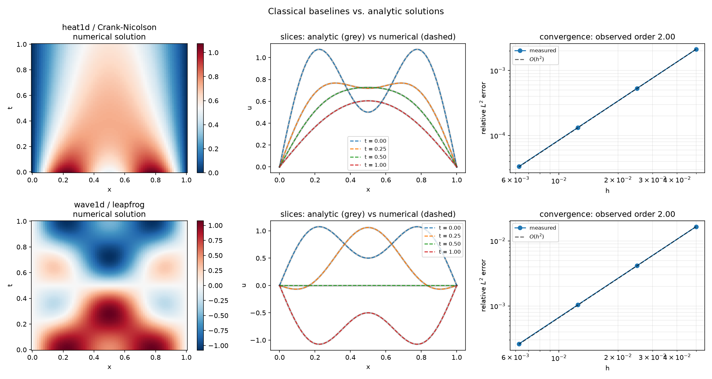

# pinn-audit


**Neural networks are being sold as PDE solvers. This repo checks whether you should buy one.**



## The problem

Weather forecasts, heat flow in a chip, air over a wing: all of it comes down
to solving partial differential equations, and numerical solvers have been
doing that, reliably, for about seventy years.

Since 2019 there has been a rival pitch. A *physics-informed neural network*
(PINN) skips the mesh and the time-stepping, and learns the solution instead.
The promise is flexibility, and in particular that it copes with messy,
sparse measurements where classical methods struggle.

The published evidence is scattered. Some papers show spectacular results, a
few show PINNs failing on problems a first-year numerics course can solve, and
each uses its own problems, metrics and baselines. If you have to choose a
tool, there is no single place that answers the simple question: **when does
the neural network actually win?**

## The bet

> For **forward** problems, a well-built classical solver beats a PINN by
> orders of magnitude in accuracy per second. A PINN earns its place only in
> **inverse** problems (recovering unknown physical parameters) or when data
> is sparse and noisy.

I think the first half is right and I'm not sure about the second. The most
recent comparison I found (Jekic et al., 2025) has the classical method
winning on noisy inverse problems too. So this is a test I can lose, and the
repo is built so that anyone can see if I do.

## How the test works

A fair fight needs a referee nobody can argue with.

- **Exact answers.** Every test problem has a closed-form solution, so error
  is measured against the truth, not against another approximation.
- **Strong baselines.** A challenger only means something if the incumbent is
  good. Each classical scheme must reproduce its theoretical convergence order
  before it is allowed to judge anything.
- **One scoreboard.** Relative L2 error, worst-case error, and wall-clock
  time, the same for every method, on the same machine.
- **Repeats.** Neural results get several seeds and are reported with spread,
  because a single lucky training run proves nothing.
- **One config per run.** A result is fully determined by a YAML file and a
  seed, and the file is saved next to the result.

## Where it stands

The referee is built and checked. Two classical solvers are done: Crank-Nicolson
for heat flow, leapfrog for waves. Halve the grid spacing and the error drops
by a factor of four, which is what theory predicts for a second-order scheme.

| Problem | Method | Observed order | Relative L2 error, h = 1/160 |
|---|---|---|---|
| 1D heat | Crank-Nicolson | 1.996 | 3.3e-5 |
| 1D wave | Leapfrog | 1.996 | 2.6e-4 |

Two details I found while checking, both now covered by tests:

- Crank-Nicolson stays stable at a mesh ratio of 200, where the simple
  explicit scheme blows up beyond 0.5.
- At Courant number exactly 1, the leapfrog scheme reproduces the exact wave
  solution to machine precision (4e-16). That looks great and is a trap: it
  makes convergence studies meaningless, so they run at 0.5.

## Roadmap

| Milestone | Status |
|---|---|
| Exact solutions and classical baselines, verified | done |
| PINN and plain-MLP solvers behind the same interface | next |
| Burgers' equation (shocks) and 2D Poisson | planned |
| Inverse problems under noise and sparse data | planned |
| Accuracy versus cost plots, written report | planned |

## Try it

Python 3.11 or newer.

```bash
git clone https://github.com/ridoy1211/pinn-audit
cd pinn-audit
python -m venv .venv
.venv\Scripts\activate            # macOS / Linux: source .venv/bin/activate
pip install -e ".[dev]"

pytest                            # tests, including the convergence-order checks
pinnaudit convergence --config configs/heat_fd.yaml
```

The last command refines the grid four times and reports:

```
observed orders: 1.994, 1.996, 1.998
asymptotic order: 1.998
```

Regenerate the figure above with `python scripts/plot_baselines.py`.

## What's in the repo

```
src/pinnaudit/
  problems/     PDEs with exact solutions (the ground truth)
  solvers/      classical schemes; neural solvers will implement the same interface
  metrics.py    error measures and observed convergence order
  config.py     validated run configuration
  cli.py        pinnaudit run | convergence | list
configs/        one YAML file per experiment
tests/          analytic solutions, convergence order, stability, config validation
docs/LOG.md     dated lab notes, including dead ends
docs/REFERENCES.md  the five papers behind the design
```

## What this is not

It is not a new method and not a new discovery. The failure modes of PINNs are
documented (start with Krishnapriyan et al., 2021, in
[`docs/REFERENCES.md`](docs/REFERENCES.md)). What I'm adding is a small,
strict, reproducible testbed that puts the claims side by side.

## Why I built it

I finished a physics degree this year and spent the summer on machine-learning
pipelines. PINNs sit exactly between those two, and I wanted to understand
where the hype ends by measuring it myself. Disagree with a baseline or think
a test problem is missing? Open an issue.

Ridoy Hasan · [LinkedIn](https://www.linkedin.com/in/ridoy-hasan7/) · MIT licence
