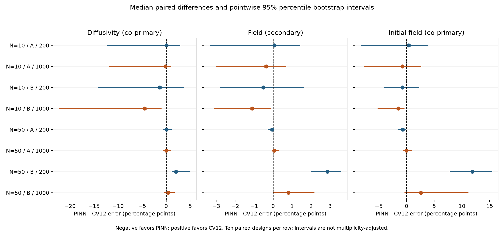

# pinn-audit

A controlled computational audit of physics-informed neural networks and classical
spectral inversion for the heat equation, with unknown diffusivity and an unknown
initial temperature field.

**Current study:** all 400 scheduled evaluation jobs are complete. PR #3 merged
the study and manuscript sections into `main` at `5000363`; CI passed for that
merge. The complete manuscript is an author-review draft, not a submission-ready
or accepted paper. See [research progress](docs/RESEARCH_PROGRESS.md) and
[the current next step](docs/NEXT_STEPS.md). Work is tracked by research stage;
earlier day-based notes are preserved in [the history archive](docs/history/README.md).

## What was investigated

We estimate a constant diffusivity and the unobserved starting temperature from
10 or 50 noisy interior observations on the unit space-time square, with known
zero Dirichlet boundaries. The synthetic truth has alpha=0.05 and absolute noise
SD=0.01. Initial field A contains sine modes 1 and 3; B adds mode 7.

Four spectral procedures distinguish six/twelve-mode representations and absent,
fixed or observation-cross-validated regularization. Two hard-boundary PINN
procedures use the same architecture and 200 or 1000 L-BFGS iterations after
2000 Adam steps. Neural architecture is not varied. All procedures receive the
same observations and diffusivity bounds within a case.

There are 40 cases from **20 independent observation/noise designs**, shared
across initial-field families. Each neural case uses three starts and both
budgets: 240 neural fits plus 160 reported classical pipeline outputs. There are
ten independent designs in each observation-count/family stratum; neural starts
are not additional independent datasets.

## Findings and limits

- At N=10/B, PINN-1000 has lower diffusivity and initial-field errors than CV12
  in nine of ten designs each, and lower full-field error in eight.
- At N=50/B, CV12 has lower full-field error than PINN-1000 in eight designs and
  PINN-200 in all ten. The longer-budget diffusivity/initial-field contrasts
  remain uncertain by the pointwise intervals.
- Several other comparisons are uncertain. No overall method-class winner,
  structural-identifiability theorem or convergence certificate is established.
- Six-mode fitting cannot express B's seventh component: its initial-field
  relative-L2 error floor is 21.82%. The richer classical representation contains
  the truth and is favorable to that reference.

Selected marginal median errors (%) are below. Every condition has ten designs;
neural scores first take the median over three starts separately per outcome.
These are not ensemble predictions or the best initialization. The paired effects
are computed within designs and differ from subtracting marginal medians.

| N | initial field | procedure | diffusivity error | field error | initial-field error |
|---|---|---|---:|---:|---:|
| 10 | A | CV12 | 4.755 | 3.942 | 10.900 |
| 10 | A | PINN-1000 | 2.580 | 3.842 | 8.963 |
| 10 | B | CV12 | 11.752 | 7.402 | 26.111 |
| 10 | B | PINN-1000 | 3.400 | 6.071 | 23.368 |
| 50 | A | CV12 | 1.607 | 0.889 | 2.919 |
| 50 | A | PINN-1000 | 1.494 | 0.909 | 2.366 |
| 50 | B | CV12 | 1.902 | 2.191 | 10.882 |
| 50 | B | PINN-1000 | 2.334 | 3.703 | 16.482 |

[All six procedures and 24 paired contrasts](results/broader_analysis_v1/summary.md)
retain favorable, unfavorable and uncertain outcomes. Intervals are pointwise
95% percentile bootstrap intervals from ten designs per stratum, without
multiplicity correction. All jobs completed; some finite fits still have large
recovery errors. Completion does not certify convergence.



This is a specified-pipeline comparison, not equal-compute or equally tuned
method classes. Classical regularization uses cross-validation; neural settings
are fixed from development. One domain, one true diffusivity, one noise level,
finite spectral truths and limited initialization sampling restrict scope.
There is no observation-timing or high-dimensional study in this evaluation.

## Evidence and manuscript guide

- [Fixed protocol](docs/BROADER_COMPARISON_PROTOCOL.md) and
  [committed freeze](docs/BROADER_COMPARISON_FREEZE.json): versioned before
  evaluation data generation; not formal preregistration. The protocol's
  pre-run wording is preserved as frozen evidence.
- [Main data/models/manifest](results/broader_study_v1/) and
  [prespecified analysis](results/broader_analysis_v1/).
- [Numerical review and figures](results/broader_results_review_v1/) and
  [critical result interpretation](docs/MAIN_STUDY_RESULTS_REVIEW.md).
- [Complete author-review manuscript](docs/MANUSCRIPT_REVIEW_DRAFT.md), including
  abstract, conclusion and provisional declarations; [title-page preparation](docs/TITLE_PAGE_DRAFT.md).
- Draft sections: [Introduction](docs/INTRODUCTION_DRAFT.md),
  [Methods](docs/METHODS_DRAFT.md), [Results](docs/RESULTS_DRAFT.md),
  [Discussion](docs/DISCUSSION_DRAFT.md). These are drafts, not an accepted paper.
- Plain-language reading: [methods](docs/methods.md) and [results](docs/result.md).
- [Contribution limits](docs/NOVELTY_ASSESSMENT.md) and
  [verified related-work notes](audit/literature_review.md).

Implementation checkpoint: `b9d2b3e`; committed freeze: `dad8cd5`; complete
experiment archive: `4a64ed4`; section-draft checkpoint: `0977887`.

## Reproduce the saved analysis

Python 3.11 or newer is the package's declared minimum. The main collection used
Python 3.14.6 and Torch 2.15.0+cpu; see the saved run manifest for actual metadata.
The commands below install declared dependencies; they are not a complete
version-pinned reconstruction of the collection environment.

```bat
git clone https://github.com/ridoy1211/pinn-audit.git
cd pinn-audit
git checkout 09778874da8c14f4103d6b41dc31aff4b154aba8
python -m venv .venv
.venv\Scripts\activate
python -m pip install -e ".[dev,nn]"
python -m pytest
python scripts/analyze_broader_study.py --results results\broader_study_v1 --out-dir results\broader_analysis_replay_01
```

Use a fresh analysis output directory every time. This command analyzes saved
outcomes; it does not retrain the models. Historical collection commands are in
[the workflow record](docs/BROADER_STUDY_COMMANDS.md). Preserve completed runs and
frozen sources rather than overwriting them or selecting a preferred outcome.

CI runs on pushes to `main` and `broader-comparison-implementation`, and on pull
requests. [The merged-study check](https://github.com/ridoy1211/pinn-audit/actions/runs/41974830481)
passed at `5000363`. Each later checkpoint needs its own check; an earlier success
does not certify later edits. The saved-analysis replay is documented separately
in [the reproducibility audit](audit/github_repository_check_2026-11-05.json).

## Earlier work and provenance boundary

The repository began with forward heat/wave tests and exploratory inverse
comparisons. Its historical README is preserved
[at the section-draft checkpoint](https://github.com/ridoy1211/pinn-audit/blob/09778874da8c14f4103d6b41dc31aff4b154aba8/README.md),
and the original dated entries remain in [the lab log](docs/LOG.md).
Historical neural tables could not be independently regenerated during the
initial audit because their original raw run records were unavailable. They
must not be treated as verified by the new inverse study or reused as its
current headline results. See [the original evidence boundary](docs/SUPERVISOR_AUDIT.md).

The current classical procedure is spectral inversion, not a FEM/FDM benchmark.
The earlier finite-difference code remains available for its original tasks.

## Authorship and assistance

AI tools supported software development and debugging, analysis automation,
literature review, and manuscript preparation. The author retains responsibility
for the research decisions, interpretation, verification of results and references,
and the final manuscript.

Licensed under the [MIT License](LICENSE).
