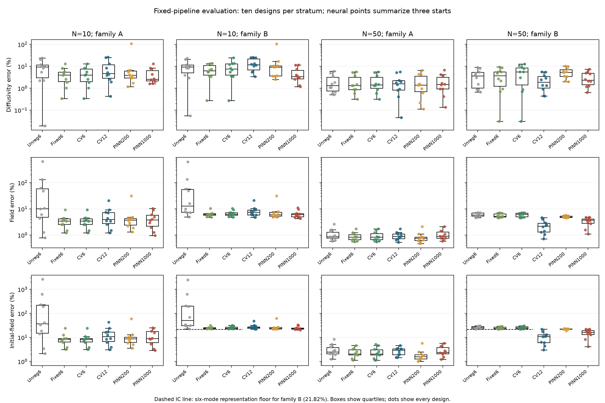
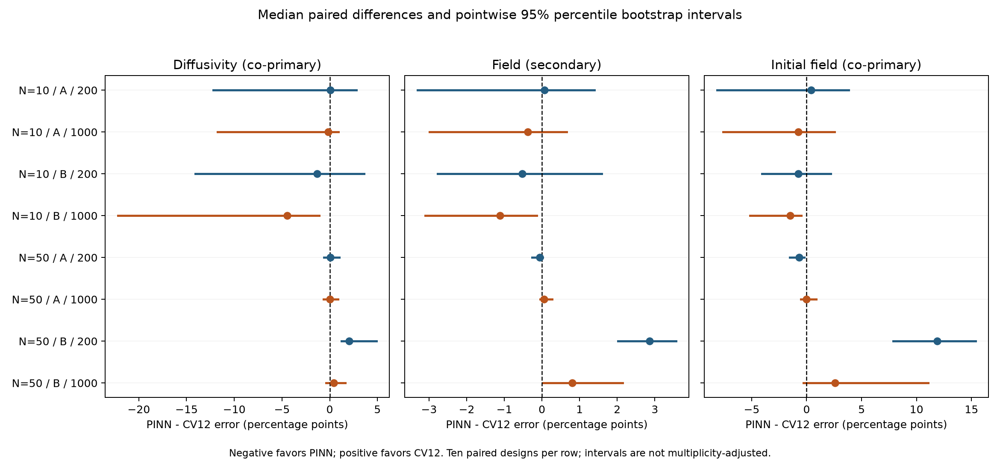

# Regularization, Initial-State Representation, and Optimization Budget in a Controlled Audit of Physics-Informed Heat Inversion

Ridoy Hasan

Proposed affiliation: Unaffiliated, Comilla, Bangladesh

Correspondence: hasanridoy@stud.cou.ac.bd

**For author review.** Additional coauthors remain undecided. Affiliation,
contributions, final author approval and journal formatting are not finalized.
The degree in Physics from Comilla University is recorded as education rather
than institutional affiliation for this independent project. Funding and
competing-interest statements reflect the currently named author's confirmation.
This draft is not ready for submission.

## Abstract

**Purpose:** We examine how classical regularization, initial-state representation
and neural optimization budget affect comparisons in joint recovery of constant
diffusivity and an unknown initial temperature field.

**Methods:** A prospectively versioned one-dimensional heat benchmark used two
initial fields, 10 or 50 noisy observations, and 20 independent observation/noise
designs, shared across field families to form 40 cases. Four spectral inverse
procedures varied regularization and six- or twelve-mode representations. Two
hard-boundary physics-informed neural network procedures used fixed architecture,
three initializations per case, and 200 or 1000 L-BFGS iterations after Adam.
We separately assessed diffusivity, initial-field and full-field errors, with
paired comparisons against cross-validated twelve-mode inversion (CV12).

**Results:** All 400 scheduled jobs completed. For the richer initial field with
10 observations, the longer-budget neural procedure had lower diffusivity and
initial-field errors than CV12 in nine of ten designs each. With 50 observations,
CV12 had lower full-field error in eight of ten designs. Several contrasts
remained uncertain under pointwise bootstrap intervals. The six-mode
representation imposed a 21.82% initial-field error floor for the richer pattern.

**Conclusion:** Comparative conclusions varied with the specified procedure,
observation regime and recovery target. The results support a limited pipeline
audit rather than a universal ranking. Spectral truth, unequal tuning opportunities
and ten designs per condition limit generalization.

**Keywords:** Physics-informed neural networks; inverse heat conduction; joint parameter and state estimation; regularization; spectral methods; computational benchmarking.

## 1. Introduction

Estimating a physical transport coefficient from temperature observations is
more demanding when the starting temperature distribution is also unknown.
For the heat equation, each initial sine component decays at a rate proportional
to diffusivity and the square of its spatial frequency. Consequently, estimating
diffusivity and reconstructing the initial field are coupled tasks, and errors
in the recovered coefficient, initial state and space-time field need not move
together. A comparison based on only one of these outcomes can obscure important
differences between inverse procedures.

Neither joint heat inversion nor neural recovery of unobserved states is new.
Zhao, Banda and Guo developed a classical procedure for simultaneous recovery
of diffusivity, a spatial source and the initial state, using boundary control,
boundary observations and a distributed temperature snapshot. Their observation
and excitation conditions differ from the sparse interior observations examined
here. [Zhao et al. (2017)](https://doi.org/10.1002/mma.4245)
Oliveira and colleagues studied initial-temperature reconstruction with several
physics-informed learning formulations for a heat problem with specified
diffusivity. [Oliveira et al. (2026)](https://doi.org/10.1007/s40314-026-03818-x)

Comparative evidence also predates the present study. Grossmann and colleagues
compared PINNs with finite elements across forward PDE problems and distinguished
solution construction from subsequent evaluation. Their results motivate explicit
numerical references and cost definitions, but do not resolve the joint inverse
problem studied here. [Grossmann et al. (2024)](https://doi.org/10.1093/imamat/hxae011)
Zapf and colleagues compared PINN and finite-element estimation of apparent
diffusivity from brain tracer images, demonstrating the relevance of training
formulation in a noisy inverse application. Their treatment of initial and
boundary information differs from our unknown-initial-field formulation.
[Zapf et al. (2022)](https://doi.org/10.1038/s41598-022-19157-w)
Jekic and colleagues examined noisy inverse fluid problems using PINNs and a
finite-element/optimization reference, with prescribed initial-condition data.
Their work establishes a direct precedent for noisy inverse benchmarking, rather
than evidence that such comparisons remain unexplored.
[Jekic et al., preprint v2 (2026)](https://arxiv.org/html/2509.20191v2)

These precedents motivate a more specific question: **for joint constant-
diffusivity and unknown-initial-field heat inversion, how does the comparison
between specified neural and classical procedures change when initial-state
regularization, basis capacity and neural optimizer budget are made explicit?**
The purpose is to examine the sensitivity of comparative conclusions, rather
than to introduce a new solver or establish a ranking of entire method classes.

We address this question with an analytically generated one-dimensional heat
benchmark, two initial-state families and two observation counts. Four spectral
inverse procedures distinguish absent, fixed and observation-selected
regularization, and six- versus twelve-mode representations. Two hard-boundary
PINN procedures retain different L-BFGS iteration budgets after the same Adam
stage. Observations, realized noise and diffusivity bounds are shared across
procedures within each case. Diffusivity, initial-state and full-field errors
are evaluated separately, with dataset-level neural initialization summaries,
paired contrasts and a complete outcome archive.

The simulation, procedures and primary analysis were versioned before generating
the evaluation data. This prospective design reduces opportunities for selecting
favorable cases after inspection; it is not formal preregistration. The spectral
truth favors the classical representation, while classical cross-validation and
fixed neural settings provide different tuning opportunities. The study therefore
offers a controlled audit of specific pipelines, with explicit representation,
tuning, uncertainty and scope limits. It does not claim the first joint heat
inverse study or a universally preferable method.

## 2. Methods

### 2.1. Problem and simulation

We considered joint recovery of a constant diffusivity and an unknown initial
temperature field in the one-dimensional heat equation,

\[
u_t=\alpha u_{xx},\qquad (x,t)\in(0,1)\times(0,1],
\qquad u(0,t)=u(1,t)=0,\qquad u(x,0)=f(x).
\]

The domain and coefficients define a normalized synthetic benchmark; no material
or experimental measurement units were assigned. Both the scalar diffusivity
\(\alpha\) and the initial field \(f\) were unknown to the estimators. Boundary
values and the domain were known. The true diffusivity was 0.05. Two initial
fields were used:

\[
f_A(x)=\sin(\pi x)+0.5\sin(3\pi x),\qquad
f_B(x)=f_A(x)+0.25\sin(7\pi x).
\]

For mode amplitudes \(a_j^*\), the analytical reference was

\[
u^*(x,t)=\sum_j a_j^*\sin(j\pi x)
                 \exp[-0.05(j\pi)^2t].
\]

We sampled \(N=10\) or 50 paired space-time coordinates uniformly on the unit
square. Observations were \(y_i=u^*(x_i,t_i)+0.01z_i\), with independent standard
normal \(z_i\). The noise standard deviation was fixed in benchmark temperature
units rather than scaled by each dataset's signal. There were ten independent
observation/noise designs per observation count. Within each design, coordinates,
realized noise and validation folds were reused for families A and B. Thus the
study contained 40 dataset cases from 20 independent designs, with ten designs
in each observation-count/family stratum. The two family cases within a design
were not independent replications.

Data seeds were 6000–6009 for N=10 and 7000–7009 for N=50. No initial-field
measurements, true mode amplitudes or clean observation values were supplied to
the fitting or regularization-selection procedures. Truth was used to generate
data and to score fitted outputs.

### 2.2. Spectral reference procedures

We represented the estimated temperature field by

\[
\widehat u_M(x,t)=\sum_{j=1}^M a_j\sin(j\pi x)
                          \exp[-\alpha(j\pi)^2t].
\]

This representation satisfies the boundary conditions and heat equation exactly
for its estimated diffusivity. For each candidate diffusivity we solved

\[
\min_{\boldsymbol a}\;
 \frac{1}{N}\lVert B(\alpha)\boldsymbol a-\boldsymbol y\rVert_2^2
 +\lambda\sum_{j=1}^{M}j^4a_j^2,
\qquad B_{ij}(\alpha)=\sin(j\pi x_i)e^{-\alpha(j\pi)^2t_i}.
\]

Conditional amplitudes were computed by augmented least squares, avoiding
normal-equation formation. Diffusivity was constrained to [1e-5,1]. We evaluated
the profiled objective at 1601 points equally spaced in log diffusivity, refined
every detected interior grid-local minimum with bounded scalar minimization
(log-coordinate tolerance 1e-11), and retained the lowest objective among the
refined, grid and endpoint candidates. This search does not certify a global
minimum. Its objective profile is not a confidence interval.

Four spectral procedures were evaluated: unregularized six-mode fitting
(unreg6); six-mode fitting with fixed lambda=1e-6 (fixed6); and six- or twelve-mode
fitting with observation-based regularization selection (CV6 and CV12).
For CV6/CV12, candidates were {1e-10,1e-8,1e-6,1e-4,1e-2}. We used five balanced
folds, generated with seed 30000 plus the data seed. Every candidate was fitted
using only its training folds. Selection minimized pooled held-out squared error
divided by the total observation count, with exact ties favoring smaller lambda.
The selected candidate was refitted on all observations. Positive CV penalties
ensure unique conditional amplitude estimates, including when the training set
has fewer points than basis functions. They do not ensure joint identification
of diffusivity and amplitudes.

The twelve-mode family can represent both simulated truths, while the six-mode
family excludes the seventh component of family B. This is a deliberate
representation control. The exact spectral representation and finite spectral
truth favor the classical reference; the comparison does not make its prior
information equivalent to that of the neural field.

### 2.3. Physics-informed neural procedures

We fitted a fully connected neural field

\[
\widehat u_\theta(x,t)=x(1-x)g_\theta(x,t),
\]

where \(g_\theta\) had three hidden layers of 32 tanh units and a linear scalar
output. Inputs were scaled to [-1,1]; linear layers used Xavier-normal weights
with tanh gain and zero biases. The prefactor enforces zero boundary values
exactly. No initial-condition loss was imposed. A learnable scalar \(r\)
parameterized diffusivity by

\[
\alpha(r)=\exp\{\log(10^{-5})+
 [\log(1)-\log(10^{-5})]\operatorname{sigmoid}(r)\},
\]

initialized to alpha=0.2. We minimized

\[
\mathcal L=\frac{10}{N}\sum_i(\widehat u_\theta(x_i,t_i)-y_i)^2
 +\frac{1}{512}\sum_{k=1}^{512}
 (\partial_t\widehat u_\theta-\alpha\partial_{xx}\widehat u_\theta)^2(x_k^c,t_k^c).
\]

Derivatives were computed by automatic differentiation. The 512 uniform
collocation points, drawn with seed 314159, were fixed across all cases and
initializations. An independent set of 2048 points, seed 271828, was retained
for residual evaluation. This residual diagnostic was not a selection rule or
a substitute for reference-based recovery errors.

Both neural procedures used 2000 full-batch Adam steps, with learning rates
0.001 for network weights and 0.01 for the diffusivity parameter. These were
followed by one L-BFGS stage with either a 200-iteration cap (PINN-200) or a
1000-iteration cap (PINN-1000). L-BFGS used learning rate 1, strong-Wolfe line
search, history size 50, gradient tolerance 1e-12, change tolerance 1e-14, and
maximum evaluation settings 250 or 1250, respectively. A 600-second training
limit was declared per fit. Initializations used seeds 101, 102 and 103 for
every case and both budgets. Both budgets were retained without selecting one
using recovery error. Network settings were fixed following development work;
they were not subjected to a tuning search matching classical cross-validation.

### 2.4. Evaluation and statistical summaries

Diffusivity and initial-field errors were the co-primary reported outcomes.
Full-field error was also mandatory. We calculated

\[
E_\alpha=\frac{|\widehat\alpha-0.05|}{0.05},\qquad
E_f=\frac{\lVert\widehat u(\cdot,0)-f\rVert_{L^2(0,1)}}
                 {\lVert f\rVert_{L^2(0,1)}},\qquad
E_u=\frac{\lVert\widehat u-u^*\rVert_{L^2((0,1)^2)}}
                 {\lVert u^*\rVert_{L^2((0,1)^2)}}.
\]

Errors were evaluated by trapezoidal quadrature using 401 spatial and 401
temporal grid points and reported as percentages. A planned 801-point check
was performed for every procedure/start on the first design in each stratum,
without refitting or replacing the primary scores.

For each dataset and neural procedure, we first took the median error across
the three initializations, separately for each outcome. This describes typical
initialization performance. It is not an ensemble predictor, and its three
outcome medians need not correspond to one fitted network. Stratum summaries
then describe the ten dataset scores. All individual initialization scores were
retained.

The prespecified paired contrasts subtracted CV12 error from the corresponding
neural dataset score within each design. Differences were expressed in percentage
points; negative differences favor the neural procedure. We reported means,
medians, maxima and strict numerical win/tie/loss counts. Pointwise 95% percentile
bootstrap intervals for median differences used 10000 design-level resamples,
with seed 42000+N. Families were analyzed separately. These are descriptive
small-sample intervals, with no adjustment for the 24 contrasts and no unplanned
significance tests. A median paired difference is not the difference between
two marginal medians. Intervals spanning zero do not establish equivalence.

Completion was assessed before accuracy. Failures, timeouts, interruptions and
bound hits were to be retained without replacement. Three-start summaries
required complete neural triads, and intervals required all ten complete pairs
in a stratum. The completed study met these requirements throughout.

### 2.5. Prospective freeze, computation and reproducibility

The implementation and protocol were committed as b9d2b3e. The freeze record
was created on 4 November 2026 at 05:46:00 UTC and committed as dad8cd5 at
05:46:12 UTC, before collection began at 05:46:59 UTC and before the first data
generation timestamp at 05:47:17 UTC. This was a prospective versioned protocol,
not formal preregistration. Earlier pilots were development work and were not
pooled into evaluation.

The run used CPU float64 computation on Windows, Python 3.14.6, NumPy 2.5.4 and
PyTorch 2.15.0+cpu. Recorded Torch/BLAS thread controls were one thread. Exact
environment details and threadpool metadata are retained in the run manifest.
Timings are measurements of these implementations on this machine, rather than
hardware-independent complexity estimates. Fitting, CV selection and evaluation
costs were recorded separately; three-start neural cost was also summarized.
CV selection-plus-selected-fit costs exclude additional nonselected full-fit
diagnostics and evaluation.

The archived evidence includes observations and folds, candidate fits and
profiles, selected amplitudes, neural checkpoints and traces, complete status
records, residual diagnostics, scoring checks and integrity manifests. Dense
fields were retained for the first design in each stratum; other fields can be
reconstructed from amplitudes or checkpoints. The complete archive is in
commit 4a64ed4cae0991bb957c18dd2bcea26162bd4e22 of
[pinn-audit](https://github.com/ridoy1211/pinn-audit/tree/4a64ed4cae0991bb957c18dd2bcea26162bd4e22).

## 3. Results

### 3.1. Completion and numerical verification

All 400 scheduled pipeline jobs completed: 160 reported classical pipeline
outputs and 240 neural fits across 40 dataset cases. Those cases originated
from 20 independent observation/noise designs; family A/B pairs shared a design.
Every observation-count/family stratum contained ten designs and every neural
case retained all three starts. There were no failed, timed-out or interrupted
jobs and no recorded bound hits. All neural fits reached their configured
L-BFGS iteration caps. Completion therefore describes a fixed-budget procedure,
not certified convergence or a global optimum.

The archived source, run-output and analysis-output hashes matched the integrity
records. The planned 401/801-point checks covered forty procedure/start outputs.
Their maximum absolute changes were 0.001868 percentage points for field error
and approximately 7.04e-8 percentage points for initial-field error. The primary
401-point scores were retained.

A supplementary post-evaluation audit recomputed 2000 held-out CV predictions
and their selection decisions, reloaded all 240 neural checkpoints, and verified
the 24 saved dense neural fields without retraining. Analytic sine-orthogonality
and time-integration checks of all 160 reported classical states agreed with
initial-field scores to floating-point precision. The largest field-score
discrepancy was 0.1632 percentage points for an unregularized fit whose field
error was about 645.5%; the CV12 maximum discrepancy was 0.00321 percentage
points. These supplementary checks do not replace the primary analysis.

### 3.2. Recovery across observation counts and initial fields

Table 1 reports all procedures. Each value is a median percentage error over ten
designs. A neural design score first takes the median of its three initialization
errors. These are marginal medians; paired effects are reported separately.

Table 1. Marginal median relative errors (%).

| N | family | procedure | diffusivity | field | initial field |
|---|---|---|---:|---:|---:|
| 10 | A | unreg6 | 9.259 | 10.242 | 37.274 |
| 10 | A | fixed6 | 4.030 | 3.439 | 8.508 |
| 10 | A | CV6 | 4.030 | 3.439 | 8.508 |
| 10 | A | CV12 | 4.755 | 3.942 | 10.900 |
| 10 | A | PINN-200 | 3.919 | 3.717 | 8.803 |
| 10 | A | PINN-1000 | 2.580 | 3.842 | 8.963 |
| 10 | B | unreg6 | 9.268 | 12.976 | 51.270 |
| 10 | B | fixed6 | 6.343 | 6.187 | 24.206 |
| 10 | B | CV6 | 7.550 | 6.278 | 24.206 |
| 10 | B | CV12 | 11.752 | 7.402 | 26.111 |
| 10 | B | PINN-200 | 9.205 | 6.040 | 23.810 |
| 10 | B | PINN-1000 | 3.400 | 6.071 | 23.368 |
| 50 | A | unreg6 | 1.325 | 0.862 | 2.473 |
| 50 | A | fixed6 | 1.326 | 0.834 | 2.064 |
| 50 | A | CV6 | 1.420 | 0.834 | 2.064 |
| 50 | A | CV12 | 1.607 | 0.889 | 2.919 |
| 50 | A | PINN-200 | 1.402 | 0.760 | 1.573 |
| 50 | A | PINN-1000 | 1.494 | 0.909 | 2.366 |
| 50 | B | unreg6 | 3.625 | 5.899 | 26.250 |
| 50 | B | fixed6 | 3.761 | 5.218 | 23.362 |
| 50 | B | CV6 | 5.526 | 6.233 | 24.982 |
| 50 | B | CV12 | 1.902 | 2.191 | 10.882 |
| 50 | B | PINN-200 | 5.356 | 4.933 | 22.352 |
| 50 | B | PINN-1000 | 2.334 | 3.703 | 16.482 |

Family A contains modes 1 and 3; family B additionally contains mode 7.
Unregularized sparse fitting showed substantial initial-field error, while
regularization reduced that error in these simulations. At N=10/A, median
initial-field error was 37.27% for unreg6, 8.51% for fixed6, 8.51% for CV6,
and 10.90% for CV12. The corresponding PINN-200 and PINN-1000 errors were
8.80% and 8.96%. These descriptive comparisons show why the choice of classical
regularization matters to an apparent neural advantage.

The denser family-B setting illustrates the importance of basis capacity.
CV6 had median initial-field error 24.98%, compared with 10.88% for CV12,
22.35% for PINN-200 and 16.48% for PINN-1000. The richer classical reference
therefore changes the comparison suggested by the restricted six-mode baseline.
Increasing basis capacity was not uniformly beneficial in the sparse case:
at N=10/B, CV12 had median initial-field error 26.11%, compared with 24.21%
for CV6. Representation alone did not ensure accurate recovery from limited
noisy observations.

### 3.3. Prespecified paired contrasts against CV12

Table 2 contains all 24 planned contrasts. Differences are neural minus CV12
in percentage points, so negative values favor the neural procedure. Each
contrast contains ten complete design pairs. Intervals are pointwise 95%
percentile bootstrap intervals for the median paired difference, not simultaneous
intervals across outcomes or procedures. Wins are strict error comparisons and
are not hypothesis tests.

Table 2. Paired differences against CV12 (percentage points). Wins/ties/losses are for the neural procedure.

| N | family | procedure | outcome | median difference | pointwise 95% interval | wins/ties/losses |
|---|---|---|---|---:|---|---|
| 10 | A | PINN-200 | diffusivity | +0.078 | [-12.210, 2.788] | 5/0/5 |
| 10 | A | PINN-200 | field | +0.072 | [-3.303, 1.391] | 4/0/6 |
| 10 | A | PINN-200 | initial field | +0.420 | [-8.141, 3.834] | 4/0/6 |
| 10 | A | PINN-1000 | diffusivity | -0.135 | [-11.756, 0.895] | 6/0/4 |
| 10 | A | PINN-1000 | field | -0.382 | [-2.983, 0.661] | 6/0/4 |
| 10 | A | PINN-1000 | initial field | -0.766 | [-7.597, 2.538] | 6/0/4 |
| 10 | B | PINN-200 | diffusivity | -1.333 | [-14.067, 3.610] | 6/0/4 |
| 10 | B | PINN-200 | field | -0.527 | [-2.774, 1.585] | 6/0/4 |
| 10 | B | PINN-200 | initial field | -0.743 | [-4.046, 2.201] | 6/0/4 |
| 10 | B | PINN-1000 | diffusivity | -4.445 | [-22.168, -1.109] | 9/0/1 |
| 10 | B | PINN-1000 | field | -1.117 | [-3.099, -0.136] | 8/0/2 |
| 10 | B | PINN-1000 | initial field | -1.508 | [-5.148, -0.467] | 9/0/1 |
| 50 | A | PINN-200 | diffusivity | +0.059 | [-0.597, 1.016] | 4/0/6 |
| 50 | A | PINN-200 | field | -0.058 | [-0.261, 0.019] | 6/0/4 |
| 50 | A | PINN-200 | initial field | -0.694 | [-1.543, -0.216] | 9/0/1 |
| 50 | A | PINN-1000 | diffusivity | +0.042 | [-0.643, 0.878] | 5/0/5 |
| 50 | A | PINN-1000 | field | +0.055 | [-0.049, 0.269] | 3/0/7 |
| 50 | A | PINN-1000 | initial field | -0.024 | [-0.516, 0.884] | 5/0/5 |
| 50 | B | PINN-200 | diffusivity | +2.031 | [1.209, 4.901] | 1/0/9 |
| 50 | B | PINN-200 | field | +2.862 | [2.021, 3.562] | 0/0/10 |
| 50 | B | PINN-200 | initial field | +11.866 | [7.869, 15.369] | 0/0/10 |
| 50 | B | PINN-1000 | diffusivity | +0.410 | [-0.386, 1.616] | 4/0/6 |
| 50 | B | PINN-1000 | field | +0.803 | [0.032, 2.142] | 2/0/8 |
| 50 | B | PINN-1000 | initial field | +2.577 | [-0.303, 11.081] | 3/0/7 |

The strongest favorable co-primary pattern for PINN-1000 occurred at N=10/B.
Its diffusivity error was lower than CV12 in nine of ten designs, with median
paired difference -4.445 percentage points (interval [-22.168,-1.109]).
Initial-field error was lower in nine designs, with median difference -1.508
percentage points (interval [-5.148,-0.467]). The mandatory field outcome also
favored PINN-1000 in eight designs, with median difference -1.117 percentage
points (interval [-3.099,-0.136]). The wide diffusivity interval and ten-design
sample limit the precision of the estimated advantage.

At N=50/B, CV12 had lower field error than PINN-200 in every design and lower
diffusivity error in nine designs. For PINN-200 minus CV12, median differences
were +2.862 percentage points for field error, +2.031 for diffusivity and
+11.866 for initial-field error; all three pointwise intervals were positive.
Against PINN-1000, CV12 had lower field error in eight designs, with median
paired difference +0.803 percentage points (interval [0.032,2.142]). The longer
budget's diffusivity and initial-field intervals spanned zero, so those outcomes
did not resolve a direction as clearly as the field comparison.

For family A, all four diffusivity contrasts had intervals spanning zero. At
N=50/A, PINN-200 had lower initial-field error in nine designs, with median
paired difference -0.694 percentage points (interval [-1.543,-0.216]); other
family-A field/initial-field intervals spanned zero. The study therefore supports
outcome- and regime-specific comparisons rather than an overall method ranking.
Intervals spanning zero do not demonstrate equal performance, and intervals
excluding zero should be interpreted in the context of small strata and multiple
pointwise comparisons.

### 3.4. Representation floor, optimizer budget and tail outcomes

For family B, orthogonality of the sine modes implies that every field restricted
to modes 1–6 has initial-field relative L2 error at least

\[
\frac{0.25}{\sqrt{1^2+0.5^2+0.25^2}}
=\sqrt{1/21}\simeq21.82\%.
\]

All sixty family-B six-mode outputs respected this floor. It describes a known
function-space restriction, not a new theorem or evidence that the seventh
mode is identifiable from the available observations. The twelve-mode reference
contains the truth and hence benefits from a favorable representation assumption.

More L-BFGS iterations did not uniformly reduce all physical recovery errors.
For example, at N=50/A the marginal median initial-field error increased from
1.57% for PINN-200 to 2.37% for PINN-1000, while field error increased from
0.76% to 0.91%. At N=50/B, the corresponding medians decreased from 22.35%
to 16.48% for the initial field and from 4.93% to 3.70% for the field. These
are descriptive budget patterns, not a newly introduced paired budget test,
proof of overfitting or a basis for choosing a budget retrospectively using truth.

Median summaries did not capture all large errors. Across individual raw fits,
unreg6 reached approximately 645.5% field error and 2622.4% initial-field error;
PINN-200 reached 107.8% diffusivity error. All outcomes were retained. The lack
of numerical failures does not imply uniformly reliable physical reconstruction
or zero failure risk beyond this sample.

### 3.5. Computational cost

Collection took about 2.66 hours. Table 3 reports median per-design costs for
CV12 selection plus the selected fit, and the summed training costs of all three
neural starts. These costs correspond to different procedures and are not an
equal-compute comparison. Neural performance summaries use three starts; a
single-start time should not be presented as their full computation cost.

Table 3. Median per-design computation costs (seconds), excluding evaluation.

| N | family | CV12 selection + selected fit | PINN-200 three-start training | PINN-1000 three-start training |
|---|---|---:|---:|---:|
| 10 | A | 7.25 | 73.91 | 115.24 |
| 10 | B | 9.56 | 83.70 | 121.64 |
| 50 | A | 11.05 | 88.67 | 124.17 |
| 50 | B | 10.40 | 95.01 | 121.62 |

Single-start neural training medians ranged from approximately 24–41 seconds
across strata and budgets. CV12 costs in Table 3 exclude nonselected full-data
candidate diagnostics and evaluation; separate timing components are retained
in the archive. These machine- and implementation-specific measurements do not
establish general timing superiority across hardware or tuned solver families.

## 4. Discussion

### 4.1. Interpretation of the comparison

The completed study does not yield a single method ranking across observation
counts, initial fields and outcomes. The longer-budget PINN's clearest favorable
co-primary pattern against CV12 occurs for the sparse family-B case: diffusivity
and initial-field errors are lower in nine of ten designs. In the denser
family-B case, CV12 has lower full-field error than the longer-budget PINN in
eight of ten designs. Several other contrasts remain uncertain. These results
support a conditional comparison of the declared procedures.

This interpretation is narrower than a claim that neural inversion succeeds
where numerical inversion cannot. Classical joint recovery already has
precedents under different measurement conditions.
[Zhao et al. (2017)](https://doi.org/10.1002/mma.4245)
Existing noisy inverse PINN–numerical comparisons also make the broader
benchmarking question established territory.
[Zapf et al. (2022)](https://doi.org/10.1038/s41598-022-19157-w),
[Jekic et al., v2 (2026)](https://arxiv.org/html/2509.20191v2)
Our contribution, if judged sufficient, is the documented sensitivity of the
comparison to explicit choices within this small joint heat-inversion problem.

### 4.2. Representation and regularization

The family-B representation control is essential to interpreting any apparent
neural advantage over six-mode inversion. That reference cannot express the
seventh sine component, and its initial-field relative error has a 21.82% floor
even with ideal coefficients for the retained modes. CV12 removes this particular
restriction. Its stronger denser-family-B recovery changes the impression given
by CV6 alone. An inadequately expressive comparator can therefore support a
different conclusion from a richer one within this benchmark.

The richer representation does not guarantee stronger sparse-data recovery.
The contrast between N=10 and N=50 is consistent with a tradeoff between allowed
complexity and the information available to constrain it, but our experiment
does not uniquely identify that mechanism. Both representation width and the
regularization selected from noisy observations affect the resulting fit.
Cross-validation targets held-out observation prediction, whereas our physical
outcomes include an unobserved initial state and a scalar coefficient.

Heat smoothing provides relevant physical context. In our analytical solution,
mode j is attenuated by exp[-alpha*(j*pi)^2*t]; higher-frequency initial detail
therefore decays faster. This explains why accurate later temperatures alone
need not ensure accurate initial-field reconstruction. It does not establish
structural non-identifiability for the chosen data or explain every numerical
failure. No uniqueness theorem or complete information analysis was established
by these comparisons.

### 4.3. Optimization budget and the recovery target

Longer training did not uniformly improve physical recovery. The family-A
N=50 median initial-field error increased from 1.57% to 2.37% between the two
budgets, while the corresponding family-B median decreased from 22.35% to
16.48%. These are descriptive patterns, not a separately tested budget effect
or proof of overfitting. Both budgets reached their iteration caps.

The neural loss combines observation discrepancy and PDE residual; it is not
the hidden-truth recovery error. A completed optimization run, small residual or
favorable single outcome should consequently not replace direct reporting of
diffusivity, initial-state and full-field scores. Retaining all starts also
reveals large errors that a median alone would conceal. Our three-start median
summarizes an outcome distribution; it is not a deployable ensemble or a model
selected without access to truth.

### 4.4. Limits of inference and fairness

There are ten independent designs in each stratum. The reported bootstrap
intervals are pointwise and unadjusted for the 24 contrasts. They should not be
read as simultaneous evidence of method-class superiority, and intervals
spanning zero do not establish equivalence. Family A/B cases share randomness;
the study contains twenty independent designs rather than forty independent
replications. Neural initializations further reuse observations and do not
increase the number of independent data designs.

The twelve-mode representation contains the generating truth, and the classical
time dependence satisfies the specified PDE exactly. This is favorable knowledge
relative to an unrestricted neural field. Conversely, classical regularization
was selected by cross-validation while neural architecture and weights were
fixed from development. These differences prevent a claim of matched priors,
equally tuned method classes or equal computation. Timing comparisons also
require distinct accounting for CV selection, selected fitting, additional
diagnostics, evaluation and all three neural starts.

Only one diffusivity, one noise level, one spatial domain and two finite
spectral initial states were investigated. Noise was independent additive
Gaussian error, PDE and boundary assumptions were correct, and the data were
synthetic. Fixed collocation and three initialization seeds do not capture all
neural training variability. Application to real measurements, model mismatch,
other noise distributions or more complex domains remains untested. Numerical
verification supports the recorded scores, not generalization beyond this setup.

### 4.5. What follows from this study

A defensible report should present the full result matrix and state exactly
which conclusions change when comparator representation, regularization or
neural budget changes. Its value would lie in a transparent, inspectable example
of comparative sensitivity, rather than a new architecture or a broad performance
claim. Whether that example adds enough to the existing literature remains an
editorial and scientific judgment.

Future investigation could examine non-spectral initial fields, multiple noise
levels and diffusivities, model mismatch, or explicitly balanced tuning budgets.
Those questions require a new protocol and fresh evaluation data. Retuning the
current cases would make them development evidence for a new procedure; their
present outcomes should remain unchanged and fully archived.

## 5. Conclusion

This controlled study compared specified neural and spectral procedures for
joint diffusivity and unknown-initial-field heat inversion. Explicit
regularization and representation controls changed the context of apparent
neural advantages, while retaining both neural budgets revealed that longer
optimization did not uniformly improve physical recovery. The strongest
favorable co-primary pattern for the longer neural budget occurred with sparse
observations of the richer initial field; denser observations favored CV12 for
the full-field comparison. Other contrasts remained uncertain.

These findings concern one synthetic heat problem, two finite spectral initial
states and fixed procedural choices. They establish neither a new solver nor
general superiority of a method class. The versioned protocol and complete
artifact archive support inspection of the conditional findings, including
unfavorable and uncertain outcomes. Broader conclusions require fresh evaluation
under additional physical, data and tuning conditions.

## 6. Statements and declarations

### Funding

This research received no external funding.

### Competing interests

The author declares no competing interests.

### Data and code availability

The source code, synthetic observations, configurations, fitted states, training
traces, analysis and integrity records are available in the
[pinn-audit repository](https://github.com/ridoy1211/pinn-audit). The completed
experiment archive is preserved at commit
[`4a64ed4cae0991bb957c18dd2bcea26162bd4e22`](https://github.com/ridoy1211/pinn-audit/tree/4a64ed4cae0991bb957c18dd2bcea26162bd4e22).
Later documentation and CI fixes do not change that archived experiment.

### Use of AI assistance

Large language model tools, including Claude and Codex/ChatGPT, assisted code
development, debugging, experiment automation, literature triage, analysis
scripting and manuscript drafting. Computational checks and source-verification
notes are retained in the repository. These checks do not replace the human
author's responsibility for the accuracy, interpretation and integrity of the
work. AI tools are not listed as authors.

### Author contributions and approval

The contribution statement and final author approval remain to be completed
after the author list is settled and each author has reviewed the manuscript.
No assertion of completed human verification or approval is made here.

### Research materials

This study uses synthetic observations of a mathematical heat model. No human
participant data, animal experiments or clinical measurements were collected
for this study. The MRI studies discussed in related work are prior literature,
not datasets analyzed in the present experiment.

## 7. Figures

### Figure 1. Errors across all six procedures

Each point represents one design-level error. Neural points summarize the three
starts separately for each outcome; they are not ensemble-model predictions.
Errors use a logarithmic vertical scale. The six-mode family-B initial-field
floor is a representation limit. Read together with Table 1, including tails.

### Figure 2. All planned paired contrasts against CV12

Differences are PINN minus CV12 in percentage points: negative favors PINN.
Intervals are pointwise 95% percentile bootstrap intervals for median paired
differences across ten designs per condition, with no multiplicity adjustment.
They are not error bars on the individual observations or simultaneous intervals.

## 8. References

- Grossmann, T. G., Komorowska, U. J., Latz, J., and Schönlieb, C.-B. (2024).
  Can physics-informed neural networks beat the finite element method?
  *IMA Journal of Applied Mathematics*, 89(1), 143-174.
  [DOI: 10.1093/imamat/hxae011](https://doi.org/10.1093/imamat/hxae011).
- Jekic, A., Natsaridou, A., Riemer-Sørensen, S., Langseth, H., and Gundersen,
  O. E. (2025; version 2, 2026). Examining the robustness of Physics-Informed
  Neural Networks to noise for Inverse Problems. *arXiv preprint* 2509.20191v2.
  [Versioned author text](https://arxiv.org/html/2509.20191v2).
- Oliveira, I. A. R., Mendes, D. A. S., Campos Velho, H. F., and Pereira, E. S.
  (2026). Solving backward heat transfer by physics-informed machine learning.
  *Computational and Applied Mathematics*, 45, 421.
  [DOI: 10.1007/s40314-026-03818-x](https://doi.org/10.1007/s40314-026-03818-x).
- Zapf, B., Haubner, J., Kuchta, M., Ringstad, G., Eide, P. K., and Mardal,
  K.-A. (2022). Investigating molecular transport in the human brain from MRI
  with physics-informed neural networks. *Scientific Reports*, 12, 15475.
  [DOI: 10.1038/s41598-022-19157-w](https://doi.org/10.1038/s41598-022-19157-w).
- Zhao, Z.-X., Banda, M. K., and Guo, B.-Z. (2017). Simultaneous identification
  of diffusion coefficient, spacewise dependent source and initial value for
  one-dimensional heat equation. *Mathematical Methods in the Applied Sciences*,
  40, 3552-3565. [DOI: 10.1002/mma.4245](https://doi.org/10.1002/mma.4245).
