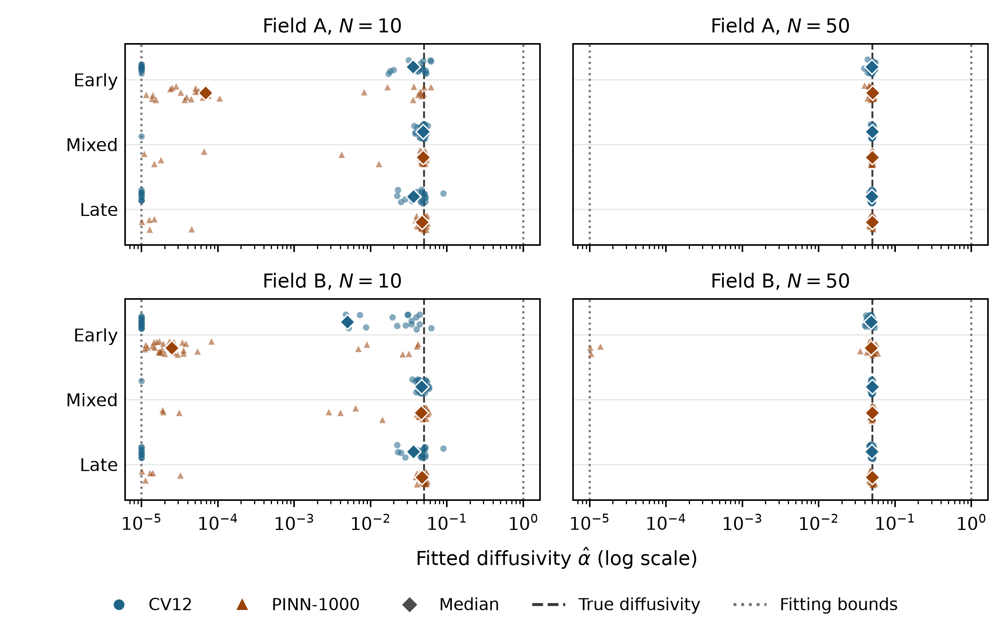

# Diffusivity estimates and fitting bounds

**Figure caption.** Each point is a completed fit from the controlled timing evaluation. Each method and schedule has 30 fits in each panel. Families and schedules share the same design/noise blocks at fixed N. Vertical offsets separate methods and reduce overplotting. Diamonds mark medians. Dashed lines mark the true diffusivity (0.05). Dotted lines mark the common bounds (1e-05, 1). All four panels use the same horizontal scale.

The table gives the median and interquartile range of fitted diffusivity divided by the lower bound. A ratio of one lies at the lower bound. Counts use the original numerical flags for proximity to either bound.

| N | Field | Schedule | CV12 ratio, median [Q1, Q3] | PINN-1000 ratio, median [Q1, Q3] | CV12 flagged / 30 | PINN-1000 flagged / 30 |
|---:|---|---|---:|---:|---:|---:|
| 10 | A | Early | 3584.8 [1, 4649.7] | 6.8447 [3.3505, 3647.9] | 10 | 0 |
| 10 | A | Mixed | 4879.3 [4546.2, 5049.6] | 4842.9 [4456.9, 5145.9] | 1 | 0 |
| 10 | A | Late | 3624.7 [1, 4747.4] | 4712.3 [4126.6, 5147.2] | 9 | 0 |
| 10 | B | Early | 493.52 [1, 3064.8] | 2.4674 [1.6737, 5.0002] | 14 | 0 |
| 10 | B | Mixed | 4639.9 [4228.3, 5059.3] | 4579.7 [4089.1, 4857.2] | 1 | 0 |
| 10 | B | Late | 3624.7 [1, 4750.7] | 4700.1 [4136.9, 5145.3] | 9 | 0 |
| 50 | A | Early | 4986.3 [4682.5, 5105.5] | 5059.9 [4722.9, 5187.9] | 0 | 0 |
| 50 | A | Mixed | 4997.7 [4918.7, 5071.8] | 4998.1 [4942.5, 5060] | 0 | 0 |
| 50 | A | Late | 4956.1 [4909.4, 5056.3] | 5013.6 [4929.9, 5074.9] | 0 | 0 |
| 50 | B | Early | 4871.1 [4670, 5021.7] | 4833.1 [4635.9, 5132.8] | 0 | 0 |
| 50 | B | Mixed | 5003.8 [4907.3, 5058.7] | 5002.9 [4941.4, 5072.8] | 0 | 0 |
| 50 | B | Late | 4955.1 [4908.7, 5054.5] | 5018.7 [4926.7, 5075.8] | 0 | 0 |

CV12 flagged 44 of 360 fits. 44 were at the lower bound to floating point precision. PINN-1000 flagged 0 of 360. Its lowest unflagged estimate was 1.002115e-05 (0.211% above the lower bound, `n10_seed906015_B_late`). For field B with ten early observations, the PINN median was 2.4674e-05, about 2.47 times the lower bound.

CV12 can return an endpoint of its search interval. PINN-1000 maps an unconstrained parameter into the allowed log-diffusivity interval using a sigmoid. Continuous distances show how near each estimator came to a bound even when its flag was false. These are descriptive distributions from the frozen timing runs. See the paired analysis for comparisons within blocks.

[Paired timing analysis](../../results/timing_evaluation_analysis_v1/summary.md)
