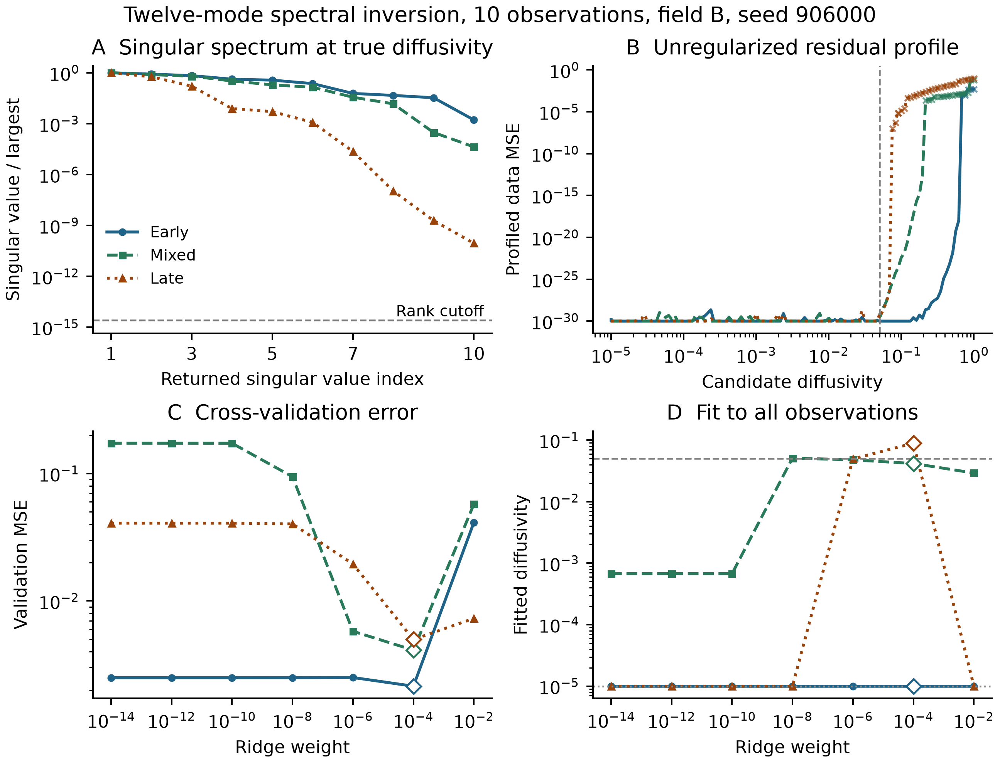

# Conditioning and ridge selection

The rank summaries below use the true diffusivity 0.05 and one copy of each design. Fields A and B share the same observation geometries. Numerical rank counts singular values above `max(N, 12) * eps * sigma_max`. The coefficient norms use field B and the minimum-norm least-squares solution.

| N | Schedule | Designs | Numerical rank | Coefficient nullity | Median smallest returned singular value / cutoff | Median coefficient L2 norm |
|---:|---|---:|---:|---:|---:|---:|
| 10 | Early | 30 | 10 | 2 | 1.34e+12 | 1.3 |
| 10 | Mixed | 30 | 10 | 2 | 2.21e+10 | 51.2 |
| 10 | Late | 30 | 10 | 2 | 1.09e+05 | 2.17e+07 |
| 50 | Early | 30 | 12 | 0 | 5.86e+12 | 1.15 |
| 50 | Mixed | 30 | 12 | 0 | 2.11e+12 | 1.15 |
| 50 | Late | 30 | 12 | 0 | 2.45e+05 | 5.01e+05 |

A full-row-rank 10 by 12 matrix has two coefficient null directions. Exact full row rank persists near any interior diffusivity with a nonzero 10 by 10 minor, because that minor varies continuously with diffusivity. Free coefficients can therefore interpolate the same observations at nearby diffusivities under that condition. For 50 observations, full column rank concerns the coefficients at fixed diffusivity.

**Figure caption.** Field B and the first frozen N=10 seed (906000) give the same example block for all three schedules. Panel A shows the ten returned singular values at diffusivity 0.05, scaled by the largest. The dashed line shows the numerical rank cutoff on that scale. Panel B profiles the data MSE over unrestricted coefficients at each candidate diffusivity. Crosses mark numerical rank below ten. Values below 1e-30 are drawn at the display floor. Panels C and D show the archived validation MSE and full-data diffusivity estimate for each candidate ridge weight. Diamonds mark the ridge weight selected by cross-validation. Dashed lines in B and D mark the true diffusivity. The dotted horizontal line in D marks the lower bound.

For this block the selected (ridge weight, fitted diffusivity) pairs are early (0.0001, 1e-05), mixed (0.0001, 0.041694), late (0.0001, 0.089105).

[Archived timing diagnostics](../../results/timing_fix2_report_v1/REPORT.md)
