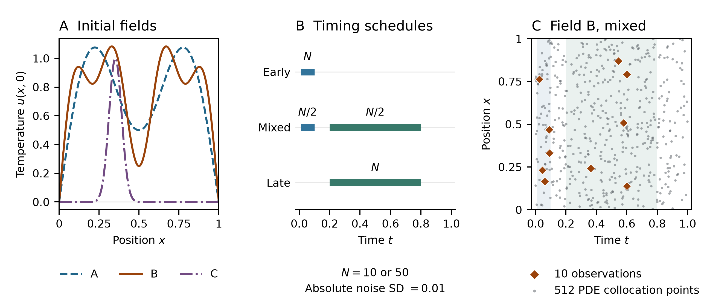

# Controlled heat inversion design

**Figure caption.** The one-dimensional heat equation uses zero temperature at both ends of the unit interval and true diffusivity 0.05. The initial field and diffusivity are unknown to the fitted procedures. **A:** A and B are the prescribed sine sums. C is a localized field proportional to $x(1-x)$ times a Gaussian centered at 0.35 with width 0.04, scaled to unit peak. **B:** Each dataset has $N=10$ or $N=50$ observations in the indicated windows. Early is [0.01, 0.10], late is [0.20, 0.80], and mixed assigns half to each window. Field C uses only mixed and late. **C:** The plotted observations are from the first frozen $N=10$ block (field B, mixed schedule, seed 906000). Both fits use these temperature measurements. The 512 gray points carry no temperature measurements and are used to evaluate the PINN's PDE loss during training.

Each study has 30 independent design/noise blocks per observation count. Fields A and B share the same blocks. Within a block the schedules reuse spatial coordinates, normalized time draws, standard normal noise draws, and cross-validation folds. The off-basis evaluation uses fresh blocks. Independent standard normal draws are multiplied by the fixed absolute noise standard deviation 0.01 and added to the simulated temperatures. Because the clean signals differ across schedules and fields, this convention does not fix signal-to-noise ratio. The schedules vary delay and time spread together.

[Timing protocol](../../docs/TIMING_PROTOCOL.md) · [Off-basis protocol](../../docs/OFFBASIS_PROTOCOL.md)
