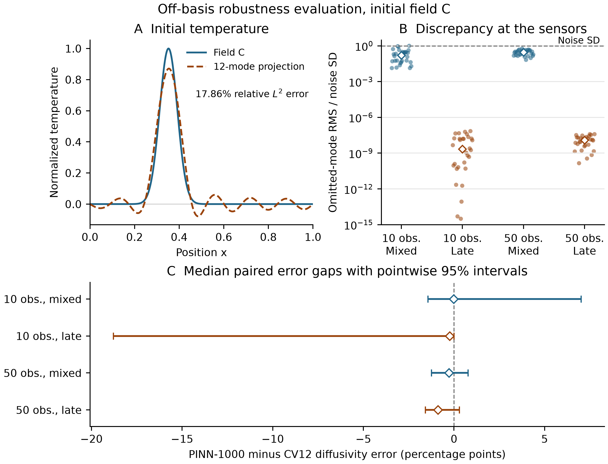

# Off-basis robustness results

The twelve-mode projection of field C has 17.86% relative L2 error at time zero. Across the late observations, the maximum absolute temperature discrepancy from the omitted modes was 2.49e-09, with a measurement noise SD of 0.01.

**Figure caption.** Panel A shows the localized initial temperature and its twelve-mode orthogonal projection. The percentage is the relative L2 error of the projection at time zero. Panel B shows the RMS contribution of modes 13 through 256 at the saved observation points, divided by the measurement noise SD. The calculation uses the true diffusivity. Each group has 30 points and a median diamond. The vertical scale is logarithmic and the dashed line marks a ratio of one. Panel C shows the medians of paired PINN-1000 minus CV12 diffusivity errors and pointwise 95% percentile bootstrap intervals. Negative gaps indicate lower PINN-1000 errors. Each interval uses 10,000 whole-block resamples.

Method errors in the table are relative absolute diffusivity errors in percent. The two schedules and methods share 30 design and noise blocks at each observation count.

| N | Schedule | CV12 median [Q1, Q3] (%) | PINN-1000 median [Q1, Q3] (%) | Median paired gap [95% CI] (pp) | Median omitted-mode RMS / noise SD |
|---:|---|---:|---:|---:|---:|
| 10 | Mixed | 74.62 [31.56, 99.98] | 73.08 [29.60, 99.95] | -0.0234 [-1.4383, 7.0112] | 0.16 |
| 10 | Late | 99.98 [98.08, 99.98] | 67.53 [34.38, 99.98] | -0.2447 [-18.7921, -0.0045] | 2.19e-09 |
| 50 | Mixed | 4.42 [2.89, 6.86] | 3.32 [1.62, 6.76] | -0.2792 [-1.2477, 0.7682] | 0.292 |
| 50 | Late | 7.95 [4.68, 10.64] | 7.68 [2.42, 10.09] | -0.8896 [-1.5833, 0.2963] | 1.25e-08 |

The secondary timing interaction subtracts the late gap from the mixed gap within each block before taking the median.

- N=10, 16.4986 pp with pointwise 95% interval [-2.3494, 38.3046].
- N=50, 0.5421 pp with pointwise 95% interval [-0.8181, 2.2548].

Both interaction intervals span zero. The sensor calculation describes the orthogonal projection at the true diffusivity. CV12 estimates diffusivity and initial coefficients from noisy data. The evaluation covers one localized field and two schedules. Its initial L2 energy differs from that of fields A and B under the same absolute noise SD.

[Archived off-basis analysis](../../results/offbasis_analysis_v1/REPORT.md)
