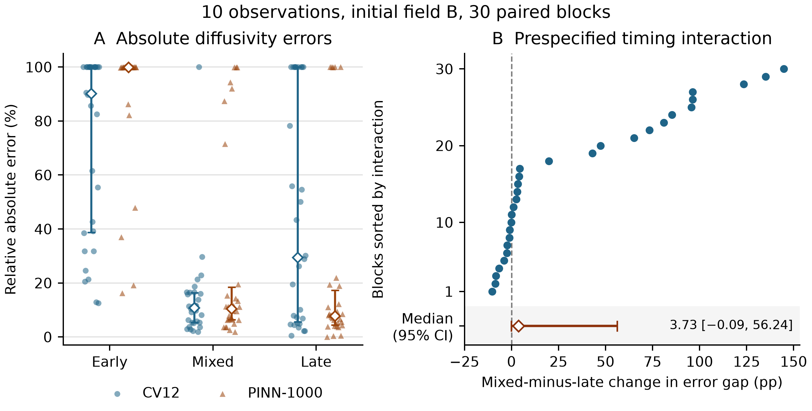

# Prespecified timing result

For 10 observations and initial field B, the median interaction was 3.7322 percentage points (95% percentile bootstrap interval [-0.0947, 56.2421]). The interval spans zero.

**Figure caption.** Panel A shows relative absolute diffusivity errors (100 times the absolute estimation error divided by the true diffusivity). Each small mark represents one block. Hollow diamonds and bars show medians and interquartile ranges. Panel B shows the interaction for each of the 30 blocks and the median with its 95% interval. For each block and schedule, the error gap is PINN-1000 error minus CV12 error in percentage points. The interaction subtracts the late gap from the mixed gap within that block. A positive interaction means the error gap is larger under mixed observations. The interval uses 10,000 whole-block resamples.

## Schedule-level results

| Schedule | CV12 median [Q1, Q3] (%) | PINN-1000 median [Q1, Q3] (%) | Median paired gap [95% CI] (pp) | Blocks with lower PINN error |
|---|---:|---:|---:|---:|
| Early | 90.13 [38.70, 99.98] | 99.95 [99.90, 99.97] | -0.008 [-0.030, 9.832] | 17/30 |
| Mixed | 10.86 [5.31, 16.37] | 10.41 [6.37, 18.48] | -0.047 [-1.516, 1.195] | 18/30 |
| Late | 29.51 [5.57, 99.98] | 7.75 [4.43, 17.26] | -0.976 [-22.424, -0.066] | 25/30 |

The two methods and the schedules share the same 30 independent design and noise blocks. The within-schedule intervals are pointwise secondary summaries.

[Archived controlled timing analysis](../../results/timing_evaluation_analysis_v1/summary.md)
